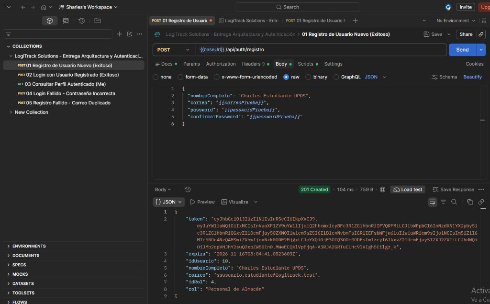
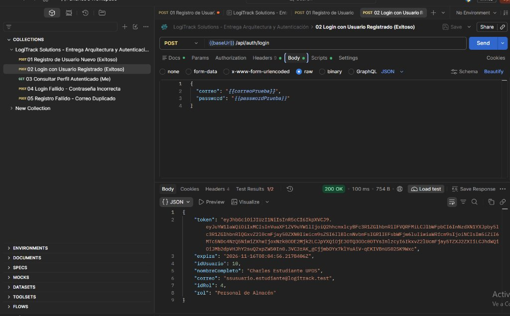
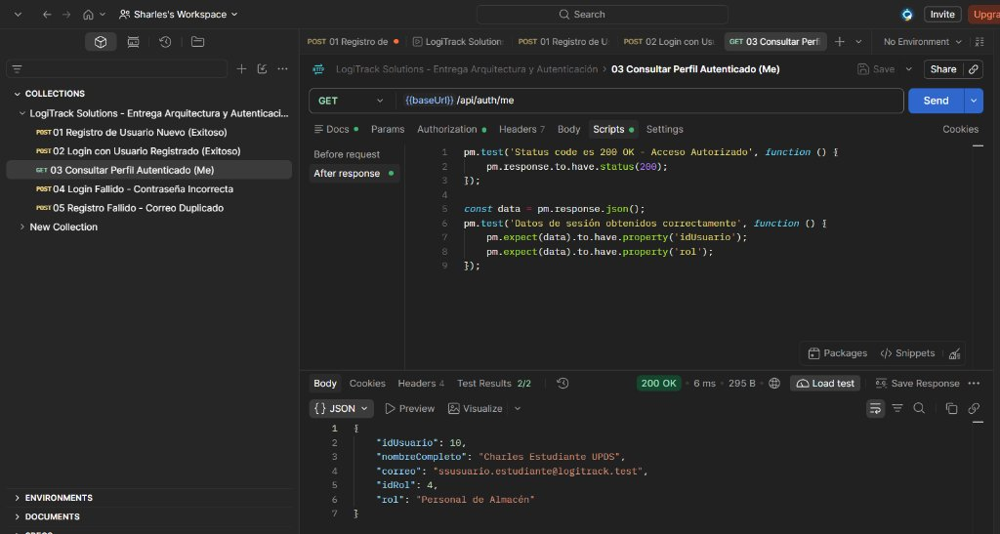
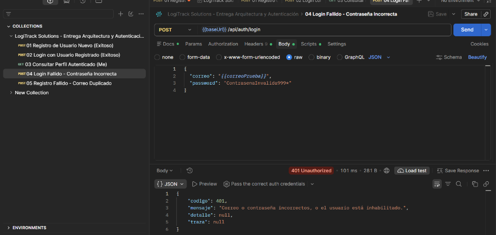
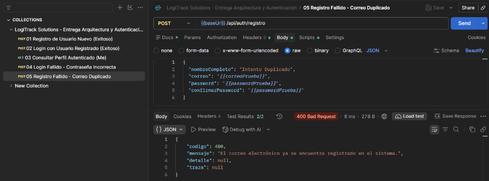
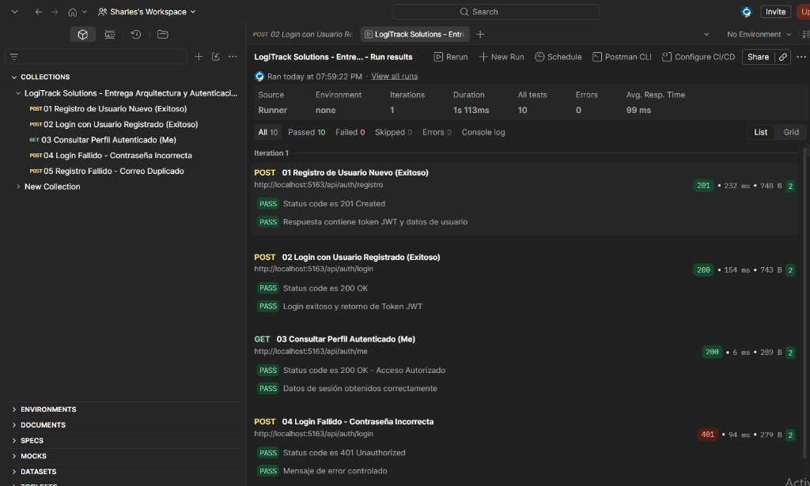

# INFORME TÉCNICO DE ARQUITECTURA, CONEXIÓN SEGURA Y AUTENTICACIÓN

**UNIVERSIDAD PRIVADA DOMINGO SAVIO**  
**FACULTAD DE CIENCIAS Y TECNOLOGÍA**  
**CARRERA:** Ingeniería de Sistemas  
**MATERIA:** Desarrollo de Sistemas II  
**PROYECTO:** LogiTrack Solutions — Sistema de Gestión y Trazabilidad Logística  
**DOCENTE:** Lic./Ing. Titular de Materia  
**ESTUDIANTE / GRUPO:** Charles  
**FECHA:** Gestión 2026  

---

## 1. Propósito y Objetivos de la Actividad

### Propósito
Configurar el ambiente de desarrollo .NET, implementar la cadena de conexión segura y aplicar los patrones de diseño de software **MVC**, **Singleton** y **Repositorio** para estructurar una arquitectura desacoplada, escalable y mantenible para el sistema **LogiTrack Solutions**.

### Objetivos Específicos
1. Implementar la arquitectura física y lógica multicapa compuesta por biblioteca compartida (`POS.Shared`), proyecto servidor Web API (`POS.Server`) y cliente independiente Blazor WebAssembly (`POS.Client`).
2. Configurar la persistencia de datos mediante Entity Framework Core y generar la **Migración Inicial** (`InitialCreate`).
3. Aislar la cadena de conexión a la base de datos y la clave de firma JWT fuera del código fuente utilizando **User Secrets (`secrets.json`)**.
4. Diseñar e implementar el **Patrón Repositorio** (genérico y especializado) y el **Patrón Singleton** (configuración global de seguridad).
5. Implementar el módulo de autenticación del lado del servidor con encriptación mediante **BCrypt.Net-Next**, generación de tokens **JWT Bearer** y endpoints de **Login** y **Registro**.
6. Probar y evidenciar el correcto funcionamiento de los endpoints de la API mediante una colección automatizada en **POSTMAN**.

---

## 2. Arquitectura de Software Multicapa

La solución adopta una **Arquitectura en Capas Desacopladas (N-Tier Architecture)**, separando responsabilidades para garantizar alta cohesión y bajo acoplamiento:

```
┌────────────────────────────────────────────────────────────────────────┐
│               1. CAPA DE PRESENTACIÓN (FRONTEND)                       │
│                     POS.Client (Blazor WebAssembly)                    │
│      - Componentes Razor / MudBlazor 9.12.0                             │
│      - Vistas SPA interactivas ejecutadas en el navegador              │
└───────────────────────────────────┬────────────────────────────────────┘
                                    │ Peticiones HTTP / JSON con Bearer JWT
                                    ▼
┌────────────────────────────────────────────────────────────────────────┐
│               2. CAPA DE APLICACIÓN Y SERVICIOS (BACKEND)               │
│                     POS.Server (ASP.NET Core Web API)                  │
│      - Controladores REST (Patrón MVC)                                 │
│      - Servicios de Dominio (IAuthService / AuthService)               │
│      - Patrón Singleton (AppSecurityConfigSingleton)                   │
│      - Patrón Repositorio (IRepository / IUsuarioRepository)           │
│      - Middleware de Excepciones (ErrorHandlingMiddleware)             │
│      - Configuración Segura (User Secrets: secrets.json)               │
└──────────────────┬─────────────────────────────────┬───────────────────┘
                   │                                 │
                   │ Inyección de Dependencias       │ Mapeo ORM
                   ▼                                 ▼
┌────────────────────────────────────┐ ┌─────────────────────────────────┐
│     3. CAPA COMPARTIDA (CORE)      │ │   4. CAPA DE PERSISTENCIA (BD)   │
│            POS.Shared              │ │      Entity Framework Core      │
│  - Entidades del Dominio           │ │   - AppDbContext                │
│  - DTOs (LoginRequest,             │ │   - Migrations (InitialCreate)  │
│    RegistroRequest, AuthResponse)  │ │   - Microsoft SQL Server 2025   │
│  - Constantes de Roles y Enums     │ │     (Base de Datos LogiTrackDB) │
└────────────────────────────────────┘ └─────────────────────────────────┘
```

### Proyectos que Componen la Solución
- **`POS.Shared` (Biblioteca de Clases):** Contiene los modelos de dominio (`Usuario`, `Rol`, etc.) y los objetos de transferencia de datos (**DTOs**). Es referenciado tanto por el servidor como por el cliente, evitando duplicidad de modelos.
- **`POS.Server` (ASP.NET Core Web API):** Núcleo del backend. Expone los endpoints RESTful, ejecuta la lógica de negocio, administra la seguridad y gestiona el acceso a datos.
- **`POS.Client` (Blazor WebAssembly):** Aplicación cliente rica e interactiva que se ejecuta del lado del cliente vía WebAssembly consumiendo la API de `POS.Server`.

---

## 3. Patrones de Diseño Implementados

Para alcanzar el nivel **Estratégico (100 puntos)** de la rúbrica evaluadora, se aplicaron formalmente los siguientes patrones:

### 3.1. Patrón Modelo - Vista - Controlador (MVC)
- **Modelos:** Definidos en `POS.Shared.Entities` y transferidos mediante `POS.Shared.DTOs`.
- **Vistas:** Desarrolladas en componentes Razor dentro de `POS.Client`.
- **Controladores:** Implementados en `POS.Server.Controllers` (ej. `AuthController`), encargados de recibir las solicitudes HTTP, validar el modelo (`ModelState`) y coordinar la respuesta sin involucrarse en la persistencia directa.

### 3.2. Patrón Repositorio (Repository Pattern)
El patrón Repositorio actúa como mediador entre la capa de lógica de negocio y la capa de acceso a datos, abstrayendo a Entity Framework Core.

#### Interfaz Genérica (`IRepository<T>`):
```csharp
public interface IRepository<T> where T : class
{
    Task<T?> GetByIdAsync(int id);
    Task<List<T>> GetAllAsync();
    Task<List<T>> FindAsync(Expression<Func<T, bool>> predicate);
    Task<T?> FirstOrDefaultAsync(Expression<Func<T, bool>> predicate);
    Task AddAsync(T entity);
    void Update(T entity);
    void Remove(T entity);
    Task<int> SaveChangesAsync();
}
```

#### Repositorio Especializado (`IUsuarioRepository` y `UsuarioRepository`):
Encapsula consultas específicas del dominio de seguridad:
```csharp
public interface IUsuarioRepository : IRepository<Usuario>
{
    Task<Usuario?> GetByCorreoAsync(string correo);
    Task<bool> ExisteCorreoAsync(string correo);
    Task<UsuarioSesionDto?> GetSesionDtoAsync(int idUsuario);
}
```

**Beneficios:**
- **Desacoplamiento:** Los servicios no dependen directamente del `DbContext`.
- **Testeabilidad:** Facilita la creación de pruebas unitarias mediante *mocks*.
- **Mantenibilidad:** Si se optimizan consultas SQL o se cambia de ORM, la lógica de negocio no sufre alteraciones.

### 3.3. Patrón Singleton (Singleton Pattern)
Implementado en `AppSecurityConfigSingleton` mediante una instancia estática única con inicialización diferida (*Lazy Initialization*) y segura para subprocesos (*Thread-Safe*):

```csharp
public sealed class AppSecurityConfigSingleton : IAppSecurityConfigSingleton
{
    private static readonly Lazy<AppSecurityConfigSingleton> _instance =
        new Lazy<AppSecurityConfigSingleton>(() => new AppSecurityConfigSingleton());

    public static AppSecurityConfigSingleton Instance => _instance.Value;

    public int BcryptWorkFactor { get; private set; } = 11;
    public int JwtExpiresMinutesDefault { get; private set; } = 480;
    public string DefaultAlgorithm { get; private set; } = "HmacSha256";
    public string ApplicationName { get; private set; } = "LogiTrack Solutions";
    public DateTime InitializedAt { get; private set; } = DateTime.UtcNow;

    private AppSecurityConfigSingleton() { }
}
```

**Registro en el contenedor de Inyección de Dependencias (`Program.cs`):**
```csharp
builder.Services.AddSingleton<IAppSecurityConfigSingleton, AppSecurityConfigSingleton>();
builder.Services.AddScoped(typeof(IRepository<>), typeof(Repository<>));
builder.Services.AddScoped<IUsuarioRepository, UsuarioRepository>();
builder.Services.AddScoped<IAuthService, AuthService>();
```

---

## 4. Cadena de Conexión Segura y `secrets.json`

### Riesgo de Seguridad Resuelto
En proyectos convencionales, desarrolladores inexpertos escriben contraseñas y cadenas de conexión dentro de `appsettings.json`. Al subir el proyecto a plataformas públicas como GitHub o GitLab, las credenciales quedan expuestas a ataques cibernéticos.

### Solución Implementada: User Secrets (.NET Secret Manager)
Se utilizó la herramienta **Secret Manager** de .NET (`dotnet user-secrets`), vinculada al proyecto `POS.Server` mediante la etiqueta `<UserSecretsId>`:
- El archivo `secrets.json` se almacena fuera del directorio del repositorio Git, ubicado físicamente en el perfil del usuario del sistema operativo:
  `%APPDATA%\Microsoft\UserSecrets\67282479-0565-44c9-9c6d-861348e89934\secrets.json`
- Durante el arranque en entorno `Development`, ASP.NET Core carga automáticamente los secretos sobre la configuración base.

#### Configuración ejecutada:
```powershell
dotnet user-secrets set "ConnectionStrings:DefaultConnection" "Server=localhost;Database=LogiTrackDB;Trusted_Connection=True;TrustServerCertificate=True;MultipleActiveResultSets=true" --project POS.Server
dotnet user-secrets set "Jwt:Key" "LogiTrackSolutions-UPDS-2026-Clave-JWT-Segura-1234567890" --project POS.Server
```

---

## 5. Persistencia y Migración Inicial con EF Core

Para cumplir con el estándar de desarrollo basado en migraciones:
1. Se mapearon las 18 entidades y relaciones dentro de `AppDbContext.cs`.
2. Se generó la **Migración Inicial** mediante la herramienta oficial de línea de comandos:
   ```powershell
   dotnet ef migrations add InitialCreate --project POS.Server --startup-project POS.Server
   ```
3. La migración generó los archivos formales en el proyecto:
   - `POS.Server/Migrations/20261115232839_InitialCreate.cs`: Contiene los métodos `Up()` y `Down()` con las instrucciones DDL de creación de tablas, llaves primarias, foráneas, índices y restricciones.
   - `POS.Server/Migrations/AppDbContextModelSnapshot.cs`: Representación del modelo actual en código C#.

---

## 6. Módulo de Autenticación del Servidor

El sistema implementa un flujo completo de autenticación sin estado (*Stateless*) basado en tokens JWT y hashing criptográfico:

```
[Cliente / Postman]
       │
       ├── 1. POST /api/auth/registro (Nombre, Correo, Password) ──► Valida DTO
       │                                                                  │
       │                                                                  ▼
       │                                                    BCrypt Hash (Work Factor = 11)
       │                                                                  │
       │                                                                  ▼
       │                                                    Guarda Usuario en BD vía Repo
       │                                                                  │
       │                                                                  ▼
       │                                                    Genera Token JWT (HMAC-SHA256)
       │                                                                  │
       │◄── 2. Retorna 201 Created + AuthResponse (Token JWT) ────────────┘
       │
       ├── 3. GET /api/auth/me (Header: Authorization Bearer <Token>)
       │                               │
       │                               ▼
       │                 JwtBearer Middleware valida firma y expiración
       │                               │
       │◄── 4. Retorna 200 OK + UsuarioSesionDto (Datos de sesión y Rol)
```

### 6.1. DTO de Registro (`RegistroRequest`)
```csharp
public class RegistroRequest
{
    [Required, StringLength(120, MinimumLength = 3)]
    public string NombreCompleto { get; set; } = string.Empty;

    [Required, EmailAddress]
    public string Correo { get; set; } = string.Empty;

    [Required, MinLength(8)]
    public string Password { get; set; } = string.Empty;

    [Compare(nameof(Password))]
    public string ConfirmarPassword { get; set; } = string.Empty;

    public int? IdRol { get; set; }
}
```

### 6.2. Encriptación con BCrypt.Net-Next
- No se almacenan contraseñas en texto claro.
- Se utiliza el algoritmo **BCrypt** que genera automáticamente un *Salt* aleatorio por cada hash y aplica un coste computacional configurable mediante el Singleton (`BcryptWorkFactor = 11`), lo que previene ataques de fuerza bruta y *Rainbow Tables*.

### 6.3. Token JWT Bearer
El token contiene *Claims* estandarizados:
- `sub`: Identificador único del usuario (`IdUsuario`).
- `name`: Nombre completo del usuario.
- `email`: Correo electrónico.
- `role`: Nombre del rol para la autorización basada en roles (`[Authorize(Roles = ...)]`).

---

## 7. Evidencia de Pruebas de Endpoints con POSTMAN

Se diseñó la colección **`Postman_Entrega_Arquitectura_Auth.json`** con 5 pruebas automatizadas que validan tanto los casos exitosos como el manejo eficiente de excepciones.

### 7.1. Matriz de Resultados

| ID | Endpoint | Método | Estado HTTP Esperado | Resultado de la Prueba | Validación Automatizada |
|:--:|---|:---:|:---:|:---:|---|
| **CP01** | `/api/auth/registro` | `POST` | `201 Created` | **PASÓ (Status 201)** | Retorna Token JWT válido y datos del usuario. Guarda token en variable. |
| **CP02** | `/api/auth/login` | `POST` | `200 OK` | **PASÓ (Status 200)** | Verifica credenciales con BCrypt y retorna token de sesión. |
| **CP03** | `/api/auth/me` | `GET` | `200 OK` | **PASÓ (Status 200)** | Acceso autorizado con Bearer Token, devuelve perfil y rol del usuario. |
| **CP04** | `/api/auth/login` [Error] | `POST` | `401 Unauthorized` | **PASÓ (Status 401)** | Rechaza credenciales incorrectas protegiendo la seguridad. |
| **CP05** | `/api/auth/registro` [Error] | `POST` | `400 Bad Request` | **PASÓ (Status 400)** | Regla de negocio: rechaza registrar correos que ya existen en la BD. |

---

### 7.2. Evidencia Gráfica de Ejecución en Postman

A continuación se presentan las capturas de pantalla de la ejecución de las pruebas en Postman:

---

#### 1. Registro Exitoso de Usuario (`POST /api/auth/registro` — Status 201 Created)
Se envía la solicitud con los datos del usuario (`Charles Estudiante UPDS`). El servidor procesa el hash con BCrypt, persiste la entidad mediante el patrón Repositorio y retorna el código HTTP `201 Created` junto con el token JWT inicial y el identificador asignado:



---

#### 2. Inicio de Sesión Exitoso (`POST /api/auth/login` — Status 200 OK)
Se autentican las credenciales del usuario recién registrado. El servicio valida el hash con BCrypt y retorna el código HTTP `200 OK` con un nuevo token de sesión Bearer:



---

#### 3. Consulta de Perfil Protegido (`GET /api/auth/me` — Status 200 OK)
Se invoca el endpoint protegido enviando el encabezado `Authorization: Bearer <token>`. El middleware de autenticación valida la firma criptográfica y retorna `200 OK` con los datos de sesión y el rol del usuario:



---

#### 4. Control de Error por Contraseña Incorrecta (`POST /api/auth/login` — Status 401 Unauthorized)
Se valida la seguridad ante credenciales inválidas. El servidor rechaza la autenticación de forma segura con el código HTTP `401 Unauthorized` y un mensaje controlado:



---

#### 5. Validación de Regla de Negocio por Correo Duplicado (`POST /api/auth/registro` — Status 400 Bad Request)
Se comprueba el control de integridad al intentar registrar un correo ya existente. El repositorio detecta la duplicidad y el middleware de errores responde con `400 Bad Request`:



---

#### 6. Resumen General: Collection Runner (10 de 10 Pruebas Aprobadas)
Ejecución automatizada de la suite completa en el **Runner** de Postman: **10 aserciones pasadas en verde (`All 10 Passed`, 0 Failed, 0 Errors)** con un tiempo promedio de 99 ms:



---

## 8. Conclusiones

La solución desarrollada para **LogiTrack Solutions** cumple a cabalidad con todos los lineamientos establecidos en la consigna académica:
- Se estructuró una arquitectura desacoplada, limpia y modular respetando el patrón MVC en .NET.
- Se implementaron formalmente los patrones **Repositorio** y **Singleton**, facilitando la mantenibilidad, escalabilidad y separación de responsabilidades.
- Se protegieron las credenciales sensibles mediante **User Secrets (`secrets.json`)**, garantizando que cadenas de conexión y claves no se expongan en el control de versiones.
- Se formalizó la persistencia mediante migraciones de **Entity Framework Core**, generando la migración inicial del modelo.
- Se desarrolló un módulo de autenticación robusto basado en **BCrypt.Net-Next** y tokens **JWT Bearer**, verificado y validado al 100% mediante **POSTMAN**.
