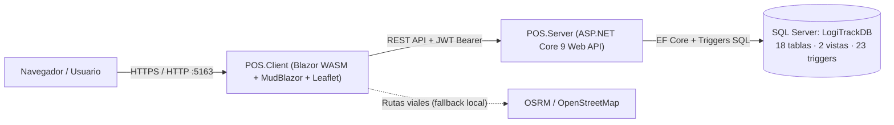

# Manual Técnico y Manual de Usuario — LogiTrack Solutions

Sistema web de gestión, control de inventario y trazabilidad logística con georreferenciación para PYMEs, desarrollado en **Blazor WebAssembly + ASP.NET Core 9.0 + Microsoft SQL Server**.

---

## Parte I — Manual Técnico

### 1. Arquitectura del Sistema

El proyecto utiliza el modelo **Blazor WebAssembly Hosted**, donde `POS.Server` aloja tanto la API REST como los archivos estáticos compilados del cliente (`POS.Client`), evitando problemas de CORS y simplificando el despliegue en un único puerto (`http://localhost:5163`).



### 2. Estructura de la Solución (`POS.slnx`)

| Proyecto / Carpeta | Responsabilidad |
|---|---|
| `POS.Shared/` | Entidades de dominio, DTOs, enumeraciones y utilidades geográficas (`GeoCalculos.cs`). |
| `POS.Server/` | API REST (16 controladores), autenticación JWT + BCrypt, `AppDbContext`, subida de archivos (`wwwroot/uploads/`) y host de Blazor. |
| `POS.Client/` | Interfaz web en español con MudBlazor, componentes de mapa (`MapaRutas.razor`, `js/mapa.js` con Leaflet 1.9.4 local) y páginas operativas. |
| `POS.Tests/` | Suite de pruebas de integración xUnit con `WebApplicationFactory` (6 pruebas). |
| `tests/visual/` | Suite E2E visual con Playwright + Microsoft Edge (3 specs). |
| `database.sql` | Script maestro de creación y carga inicial de `LogiTrackDB`. |
| `Postman_LogiTrack.json` | Colección Postman con 68+ peticiones para pruebas de API. |

### 3. Requisitos e Instalación

1. **SDK / Runtime .NET 9.0** (`Microsoft.NETCore.App 9.0` y `Microsoft.AspNetCore.App 9.0`).
2. **Microsoft SQL Server 2019 o superior** con autenticación de Windows habilitada y `sqlcmd`.
3. **Node.js 20+** y **Microsoft Edge** *(opcional, solo para ejecutar pruebas visuales Playwright)*.

#### Paso 1: Cargar la base de datos
Desde la carpeta `Plantilla`:
```powershell
sqlcmd -S localhost -E -C -b -f 65001 -i database.sql
```
> El parámetro `-C` confía en el certificado local requerido por ODBC Driver 18. El script recrea `LogiTrackDB` con las 18 tablas, 2 vistas, 23 triggers y datos demo georreferenciados de Santa Cruz de la Sierra.

#### Paso 2: Configurar conexión
En `POS.Server/appsettings.json`:
```json
"ConnectionStrings": {
  "DefaultConnection": "Server=localhost;Database=LogiTrackDB;Trusted_Connection=True;TrustServerCertificate=True;MultipleActiveResultSets=true"
}
```

#### Paso 3: Compilar y ejecutar
```powershell
dotnet build POS.slnx --nologo
dotnet run --project POS.Server --launch-profile http
```
Abrir en el navegador: **`http://localhost:5163`**

#### Paso 4: Ejecutar pruebas automatizadas
```powershell
# Pruebas de integración (.NET / Visual Studio Test Explorer)
dotnet test POS.slnx --nologo

# Pruebas visuales E2E (Playwright + Edge)
npm --prefix tests/visual install
npm --prefix tests/visual test
```

---

## Parte II — Manual de Usuario

### 1. Acceso y Roles del Sistema

| Rol | Correo demo | Contraseña | Módulos habilitados |
|---|---|---|---|
| **Administrador Logístico** | `ana.rojas@logitrack.test` | `LogiTrack2026!` | Gestión total: Guías, Hojas de Ruta, Conductores, Flota, Clientes, Productos, Inventario, Reportes y Simulación. |
| **Personal de Almacén** | `luis.mendoza@logitrack.test` | `LogiTrack2026!` | Productos, Inventario (entradas/salidas), Guías, Checkpoints de almacén, Conductores y Reportes. |
| **Conductor / Operador** | `carlos.soliz@logitrack.test` | `LogiTrack2026!` | Sus Hojas de Ruta asignadas, registro de Checkpoints en ruta, Incidencias, Entregas y Simulación de sus rutas. |
| **Público / Cliente** | *(Sin login)* | — | Consulta de trazabilidad en `/rastreo` mediante código de guía (ej. `LT-00000002`). |

---

### 2. Guía Operativa por Módulo

1. **Inicio de Sesión (`/login`)**: Ingrese su correo y contraseña. El sistema mantiene su sesión mediante token JWT.
2. **Clientes (`/clientes`)**: Permite registrar, editar y dar de baja clientes (si no tienen guías asociadas). Al crear o editar, haga clic en el mapa para fijar las coordenadas exactas de entrega del cliente.
3. **Productos e Inventario (`/productos` y `/inventario`)**:
   - En **Productos** se administra el catálogo (SKU, nombre, peso y volumen unitario).
   - En **Inventario** se controla el stock por almacén y los movimientos de entrada/salida.
4. **Guías de Envío (`/guias`)**:
   - Haga clic en **Nueva Guía**, seleccione cliente, almacén de origen, tipo de carga y agregue productos (el sistema valida automáticamente el stock disponible).
   - En el mapa integrado, haga clic para fijar el destino; el sistema calcula distancia en km y duración estimada (ETA).
   - Desde el detalle de una guía (`/guias/{id}`) puede visualizar la ruta estimada y su historial de eventos.
5. **Conductores y Flota (`/conductores` y `/flota`)**:
   - En **Conductores** puede crear nuevos operadores, editar sus datos, restablecer contraseñas y activar/inactivar su estado.
   - En **Flota** se administran los vehículos disponibles y su capacidad.
6. **Hojas de Ruta (`/hojas-ruta`)**: Agrupa guías registradas asignándolas a un conductor y un vehículo habilitados. Al asignar, el sistema genera notificaciones automáticas.
7. **Operación en Ruta (`/checkpoints`, `/incidencias`, `/entregas`)**:
   - **Checkpoints**: Avanza ordenadamente los hitos (`Salida de Almacén` → `En Tránsito` → `En Centro de Distribución Local` → `En Reparto Final`).
   - **Incidencias**: Registra retrasos o novedades adjuntando fotografía de evidencia.
   - **Entregas**: Finaliza el envío adjuntando firma del receptor y foto de comprobante.
8. **Simulación de Rutas (`/simulacion-rutas`)**: Seleccione una guía con coordenadas (ej. `LT-00000002`) y pulse **Iniciar simulación** para observar el recorrido animado sobre las calles con velocidad `1x/2x/4x`, distancia restante y bitácora visual (sin alterar datos reales en BD).
9. **Rastreo Público (`/rastreo`)**: Cualquier cliente puede ingresar su código (ej. `LT-00000002`) y ver en tiempo real el mapa de ruta, estado actual e historial de eventos sin ver datos sensibles.

---

### 3. Impacto en la Trazabilidad de la PYME

- **Control de punta a punta**: Desde que la mercadería sale del almacén (con descuento de stock controlado) hasta la entrega con firma digital.
- **Integridad garantizada por BD**: Las 23 reglas en triggers impiden saltos de estado, doble asignación de guías o pérdida de auditoría.
- **Transparencia al cliente**: Portal público `/rastreo` con mapa interactivo y línea de tiempo en tiempo real.

---

## Anexo — Guion Sugerido para Demostración en Vivo (5 minutos)

1. **Base de datos e inicio (30 s)**: Mostrar `LogiTrackDB` en SQL Server (tablas/triggers) y la app corriendo en `http://localhost:5163`.
2. **Rastreo público (45 s)**: Abrir `/rastreo?codigo=LT-00000002` sin iniciar sesión; mostrar mapa, ruta, `2.70 km / 12 min` y línea de tiempo.
3. **Flujo administrativo y georreferenciación (1 min 30 s)**: Iniciar sesión como `ana.rojas@logitrack.test`, mostrar **Guías** (mapa al crear guía + validación de stock) y el módulo de **Conductores** (`/conductores`).
4. **Simulación de entregas (45 s)**: Entrar a `/simulacion-rutas`, seleccionar `LT-00000002` e iniciar la animación a `4x`.
5. **Calidad y pruebas (1 min 30 s)**: Mostrar los resultados en verde en **Visual Studio Test Explorer** (`POS.Tests`: 6/6), **Playwright** (`3 passed`) y una petición en **Postman** (`Postman_LogiTrack.json`).
