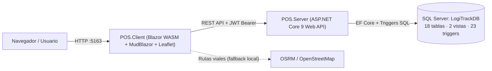

# Manual Técnico — LogiTrack Solutions

**Sistema de Gestión, Control de Inventario y Trazabilidad Logística**  
**Tecnologías:** Blazor WebAssembly (.NET 9.0) · ASP.NET Core 9.0 Web API · Entity Framework Core · Microsoft SQL Server · Leaflet 1.9.4 + OSRM

---

## 1. Arquitectura del Sistema

El sistema implementa el modelo **Blazor WebAssembly Hosted**, donde `POS.Server` sirve los archivos estáticos compilados de `POS.Client` y expone la API REST bajo el mismo origen (`http://localhost:5163`). Esto elimina configuraciones de CORS en producción y centraliza la seguridad JWT.



---

## 2. Estructura de la Solución (`POS.slnx`)

| Proyecto / Carpeta | Responsabilidad |
|---|---|
| `POS.Shared/` | Entidades de dominio, DTOs, enumeraciones y utilidades geográficas (`GeoCalculos.cs`). |
| `POS.Server/` | API REST (16 controladores), autenticación JWT + BCrypt, `AppDbContext`, carga de archivos (`wwwroot/uploads/`) y host de Blazor. |
| `POS.Client/` | Interfaz web en español con MudBlazor, componentes de mapa (`MapaRutas.razor`, `js/mapa.js` con Leaflet 1.9.4 local) y páginas operativas. |
| `POS.Tests/` | Suite de pruebas de integración xUnit con `WebApplicationFactory` (6 pruebas). |
| `tests/visual/` | Suite E2E visual con Playwright + Microsoft Edge (3 specs). |
| `database.sql` | Script maestro de creación, triggers y carga inicial de `LogiTrackDB`. |
| `Postman_LogiTrack.json` | Colección Postman con 68+ peticiones para validación de API. |

---

## 3. Modelo de Base de Datos (`LogiTrackDB`)

- **Motor:** Microsoft SQL Server 2019 o superior.
- **Objetos:** **18 tablas**, **2 vistas analíticas** (`vw_trazabilidad_publica`, `vw_reporte_envios`) y **23 triggers** que garantizan las reglas de negocio RN01–RN14 y RNF05 directamente en el motor de BD.
- **Georreferenciación:** Las tablas `dbo.almacen`, `dbo.cliente` y `dbo.guia_envio` almacenan `latitud` / `longitud` (`DECIMAL(9,6)` con restricciones `CHECK`), además de `distancia_estimada_km` y `duracion_estimada_min`.

---

## 4. Requisitos de Despliegue

1. **Runtime / SDK .NET 9.0** (`Microsoft.NETCore.App 9.0` y `Microsoft.AspNetCore.App 9.0`).
2. **Microsoft SQL Server 2019+** con autenticación de Windows habilitada y `sqlcmd`.
3. **Node.js 20+** y **Microsoft Edge** *(opcional, requerido únicamente para ejecutar las pruebas visuales Playwright)*.

---

## 5. Guía de Instalación y Puesta en Marcha

### Paso 1: Cargar la base de datos
Desde la raíz de `Plantilla`:
```powershell
sqlcmd -S localhost -E -C -b -f 65001 -i database.sql
```
> El parámetro `-C` habilita la confianza en el certificado local requerida por ODBC Driver 18. El script recrea `LogiTrackDB` e inserta los datos de demostración georreferenciados de Santa Cruz de la Sierra.

### Paso 2: Cadena de conexión y JWT
Archivo `POS.Server/appsettings.json`:
```json
"ConnectionStrings": {
  "DefaultConnection": "Server=localhost;Database=LogiTrackDB;Trusted_Connection=True;TrustServerCertificate=True;MultipleActiveResultSets=true"
}
```

### Paso 3: Compilar y levantar el servidor
```powershell
dotnet build POS.slnx --nologo
dotnet run --project POS.Server --launch-profile http
```
URL de acceso: **`http://localhost:5163`**

### Paso 4: Ejecutar pruebas automatizadas
```powershell
# Pruebas de integración (.NET / Visual Studio Test Explorer)
dotnet test POS.slnx --nologo

# Pruebas visuales E2E (Playwright + Microsoft Edge)
npm --prefix tests/visual install
npm --prefix tests/visual test
```
